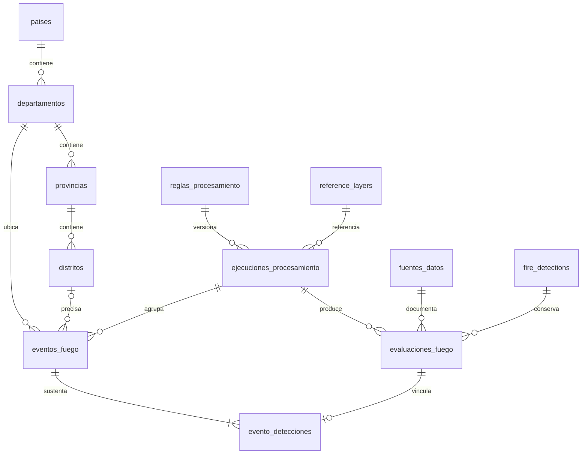

# Backend de eventos de Huánuco

## Alcance y resultado local

2026, solo el límite de Huánuco. Los 995.074 registros originales siguen intactos.
La ejecución inicial procesa 5.268 observaciones: 2 aptas agrupadas en 1 evento
forestal probable, 64 excluidas y 5.202 en revisión. Esto NO significa que solo
haya ocurrido un incendio en Huánuco: es el resultado de una política de publicación
conservadora y todavía no validada, sobre archivos incompletos y cobertura de 2025.

## Modelo relacional



Se añaden once tablas, sin reemplazar las tres existentes. `fire_detections`
es el archivo original inmutable; repetir satélite o producto en ese archivo no
se confunde con la normalización del modelo derivado. Fuentes y ubicaciones se
referencian mediante claves foráneas. País y departamento están cargados;
provincia y distrito quedan vacíos hasta importar límites oficiales verificables.
No se inventan nombres mediante aproximación. El evento muestra coordenadas reales
de su detección representativa, no un centro inventado ni un perímetro quemado.

## Reglas de publicación v1

1. Tipo NASA 1/2/3 o centro sobre agua/urbano: excluido de publicación, nunca borrado.
2. Tipo NASA desconocido: revisión. No se transforma NRT desconocido en tipo 0.
3. Bosque: códigos 3/4/5/6. Agrícola inequívoco: 35 (palma) y 40 (arroz).
   Mosaico 21, pasto 15, plantación 9 y las demás coberturas permanecen en revisión.
   Código 82 es herbazal inundable altoandino, NO agrícola.
4. Confianza mínima inicial MODIS 30–100 o VIIRS nominal/alta; FRP positiva requerida.
5. Entorno aproximado: nueve muestras (3×3) del raster nativo, separadas a media
   anchura nominal del píxel: MODIS 500 m, VIIRS 187,5 m. Al menos 70% de muestras
   de la categoría objetivo y no más de 10% de agua/urbano/sin dato. Es un muestreo
   contextual, NO la huella exacta del instrumento, ni un cálculo de superficie.
6. Para publicar: MODIS >=80 o VIIRS alta, O corroboración espacial <=1 km y <=24 h
   en otro satélite o en una observación separada >=15 min. Dos píxeles nominales
   del mismo paso no se corroboran por sí solos. Todos los pares deben pasar antes
   el contexto y la calidad. Alta confianza no constituye confirmación en campo.
7. Agrupar por la misma categoría, <=1 km de la primera detección, <=24 h del
   último registro y duración máxima de 72 h. Evitar cadenas que unan meses enteros.
   Una agrupación es una hipótesis de evento, no una identificación definitiva.

Estos umbrales son decisiones explícitas de la aplicación, no umbrales óptimos
establecidos por NASA. Favorecen precisión a costa de omitir fuegos reales, pequeños,
breves o aislados. La falta de detecciones publicadas NO significa ausencia de fuego.
No se calcula superficie quemada, causa, intencionalidad ni impacto climático.
Una quema agrícola es una clasificación probable por cobertura, no una prueba de causa.
Falta integrar máscara STA externa y contrastar con perímetros/reportes independientes.

## Ejecución y auditoría

Desde la raíz, con la base y el recorte local ya preparados:

```powershell
.venv\Scripts\python.exe data-pipeline/build_events.py
.venv\Scripts\python.exe data-pipeline/prepare_event_layers.py
$env:BRINCO_DB_TESTS='1'
.venv\Scripts\python.exe -m unittest discover -s backend/tests -v
```

El procesamiento usa una sola transacción y un bloqueo para evitar carreras. Una
ejecución nueva solo pasa a activa cuando termina: un error revierte todos sus
cambios. Las anteriores conservan sus evaluaciones y eventos. Repetir el comando
crea una nueva ejecución auditable; no duplica eventos visibles ni borra originales.
Los parámetros de una versión no pueden cambiar: se exige incrementar la versión.
La clave compuesta impide vincular miembros de ejecuciones diferentes.

Cada evaluación almacena muestras, fracciones, calidad y observaciones que aportan
corroboración. Cada evento tiene tipo, estado probable, inicio, última detección,
representante y miembros. El detalle permite revisar todos sus datos de origen.

## API que usa la interfaz

- `GET /api/huanuco/events?start=2026-01-01&end=2026-12-31`: un punto real por grupo;
  intervalos inclusivos, selecciona grupos que se solapan con el intervalo.
- `GET /api/huanuco/events/{id}`: ubicación conocida y detecciones originales asociadas;
  404 si el identificador no pertenece a la ejecución activa.
- `GET /api/huanuco/events/analysis`: auditoría, conteos y series. `daily` cuenta
  observaciones aptas por sensor; `event_daily` cuenta inicios de grupos por tipo.
  Nunca sumar ambas como si fueran la misma unidad.

Solo 2026 se admite. Parámetros SQL enlazados; fechas inválidas devuelven 422;
fallos de base devuelven 503 sin revelar credenciales. No hay endpoints públicos
de escritura ni confirmación automática. Las rutas antiguas se conservan para
compatibilidad y NO deben interpretarse como catálogo de incendios confirmados.

## Fuentes de metodología

- NASA, [atributos VIIRS](https://firms.modaps.eosdis.nasa.gov/content/descriptions/FIRMS_VIIRS_Firehotspots.html).
- NASA, [confianza: no existe un corte óptimo universal](https://forum.earthdata.nasa.gov/viewtopic.php?sid=a191ec3875dfbf155b6a12285ce9436e&t=5182).
- MapBiomas Perú, [leyenda de la Colección 4](https://peru.mapbiomas.org/iniciativas-y-productos/cobertura-y-uso-del-suelo/cobertura/).
